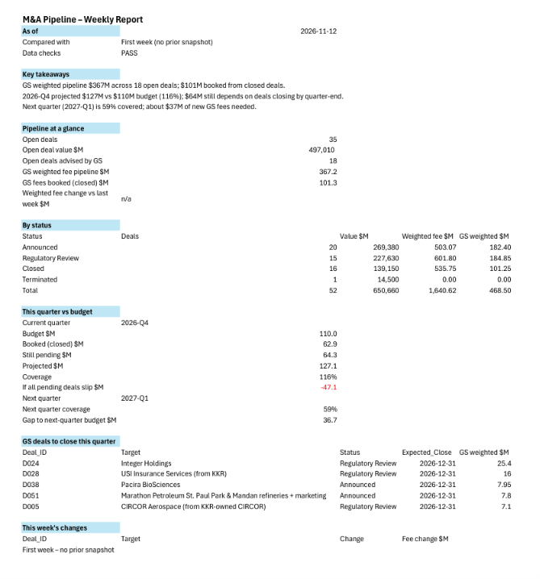

# M&A Pipeline & Advisory Fee Model

An Excel model that tracks live M&A deals, estimates advisory fees, compares an advisor's projected fee revenue against a quarterly budget, and produces a one-page weekly report. It is updated every week from public sources.

I built it to practice the work of an M&A finance team: keeping confidential deal data clean, reviewing the pipeline and fee outlook every week, and reporting the results clearly to bankers and leadership.
**Interactive dashboard:** [M&A Pipeline & Advisory Fee Dashboard on Tableau Public](https://public.tableau.com/app/profile/melanie.duong/viz/MAPipelineAdvisoryFeeDashboard/Dashboard)

---

## Results as of 2026-11-12

| Metric | Value |
|---|---|
| Deals tracked | 52 (16 closed, 15 in regulatory review, 20 announced, 1 terminated) |
| Total deal value | $650.7B |
| Advisor mandates | 155 |
| Estimated advisory fees, all deals | $2,180.2M ($1,640.6M probability-weighted) |
| Deals advised by Goldman Sachs | 24 |
| Goldman Sachs weighted fee pipeline (open deals) | $367.2M |
| Goldman Sachs fees booked (closed deals) | $101.3M |
| Q4 2026 projected vs. budget | $127.1M vs. $110.0M (116%) |
| Q4 2026 fees still depending on 5 pending closings | $64.3M (downside if all slip: −$47.1M vs. budget) |
| 2027-Q1 budget coverage | 59% (about $36.7M of new fees needed) |
| Data checks | PASS (18 rows flagged for manual review) |

## What's in the workbook

| Sheet | Purpose |
|---|---|
| `README` | Scope, sources, field definitions |
| `Deals` | One row per deal (`tbl_Deals`): parties, sector, region, value, status, dates, source link, plus calculated fee, probability, Goldman share, and week-over-week change columns |
| `Advisors` | One row per advisor per deal (`tbl_Advisors`), buy side or sell side |
| `Assumptions` | As-of date, tiered fee schedule (`tbl_Fees`), stage probabilities (`tbl_Stage`) |
| `Checks` | Automated data-integrity checks and control totals |
| `Snapshots` | Weekly frozen copy of each deal's status and weighted fee (`tbl_Snap`) |
| `Budget_vs_Actual` | Quarterly budget vs. booked and forecast fees (`tbl_Budget`) |
| `Weekly_Report` | One-page, formula-driven summary that rebuilds when the as-of date changes |
| `Lists` | Dropdown values used for data validation |

## Method

**Fee estimate.** A tiered (marginal) fee schedule, so a bigger deal never earns a smaller fee:

| Deal value tier | Fee rate on that tier |
|---|---|
| $0 – $1B | 1.00% |
| $1B – $5B | 0.50% |
| $5B – $20B | 0.25% |
| Above $20B | 0.10% |

Calculated with one `SUMPRODUCT` over the fee table: `=SUMPRODUCT((Value>Min)*(Value-Min)*Rate_Diff)`.

**Probability weighting.** Weighted fee = estimated fee × probability of closing by stage: Announced 60%, Regulatory Review 80%, Closed 100%, Terminated 0%.

**Fee timing.** Closed deals book in the quarter they closed; open deals in the quarter the companies guided to (`Expected_Close`).

**Advisor fee share.** Each side (buy or sell) is assumed to pay one fee, split equally among that side's advisors. Goldman Sachs' share = estimated fee ÷ number of advisors on its side.

**Budget.** Quarterly budgets are illustrative planning assumptions I set myself, not real figures. Coverage = (booked + probability-weighted forecast) ÷ budget.

**Status rule.** Announced = signed within the last 60 days with no later event; Regulatory Review = signed earlier and still pending; Closed = completion announced; Terminated = agreement ended.

## Data quality checks

| Check | How |
|---|---|
| Duplicate deal IDs, invalid values, missing source links, unknown statuses, missing close dates, close before announce | `Data_Errors` column (`TEXTJOIN` of rule results) |
| Stale statuses (announced > 60 days, or past expected close) | `Data_Errors` column |
| Deals with no advisors, single-source or conflicting data, assumed close dates | `Review_Notes` column |
| Advisor rows pointing to a deal that doesn't exist | `COUNTIF` across tables |
| Goldman Sachs flag disagreeing with the Advisors table | `COUNTIFS` across tables |
| Control totals: deal count, total value, total fees, weighted fees | `Checks` sheet |
| Latest snapshot's row count and weighted-fee total match the Deals table | `Checks` sheet |
| Every fee dollar is either in the budget table or explained (fees beyond the budget horizon) | Reconciliation on `Checks` |

Each check was tested by breaking the data on purpose (zero deal value, stale status, duplicate ID) and confirming the right check fired.

## Weekly update process

1. Save a dated backup copy.
2. Move the as-of date forward. The checks flag deals that need a status update.
3. Check news, company press releases, and SEC 8-K filings (Item 2.01 = deal completed) for every open deal, starting with deals due to close this quarter.
4. Add newly announced deals ($1.65B+) and their advisors.
5. Confirm all checks pass and review flagged rows.
6. Paste a values-only snapshot for the week. The `Change` and `Fee_Change_$M` columns and the weekly report update automatically.

## Data sources

Company press releases, SEC filings (8-K, 425, DEFA14A exhibits), law-firm deal announcements, and financial trade press. Every deal row links to its source. Deal lists were seeded from public monthly M&A reviews.

## Limitations

- Fee rates, stage probabilities, the advisor fee split, and budgets are simplified, illustrative assumptions. Real fees are negotiated deal by deal and are not public.
- 8 deals have no advisors found in public sources; some rows rely on a single source and are flagged for review.
- Deal values are headline figures as announced and may differ from final filings.

## Update log

| Week | Changes |
|---|---|
| 2026-11-12 | Initial build: 52 deals, 155 advisor mandates, first snapshot |

## Tools

Excel (structured tables, XLOOKUP, SUMPRODUCT, SUMIFS/COUNTIFS, FILTER, SORT, TEXTJOIN, MAXIFS, dynamic arrays, data validation, conditional formatting), Tableau Public.

---

*Personal portfolio project built from public information. Not affiliated with or endorsed by Goldman Sachs or any company named. Not investment advice.*

**Author:** Ngoc Mai (Melanie) Duong · [LinkedIn](https://www.linkedin.com/in/melanie-duong-1b8aa0254/) · [Portfolio](https://maiiduong.github.io/melanieduong.github.io/)
